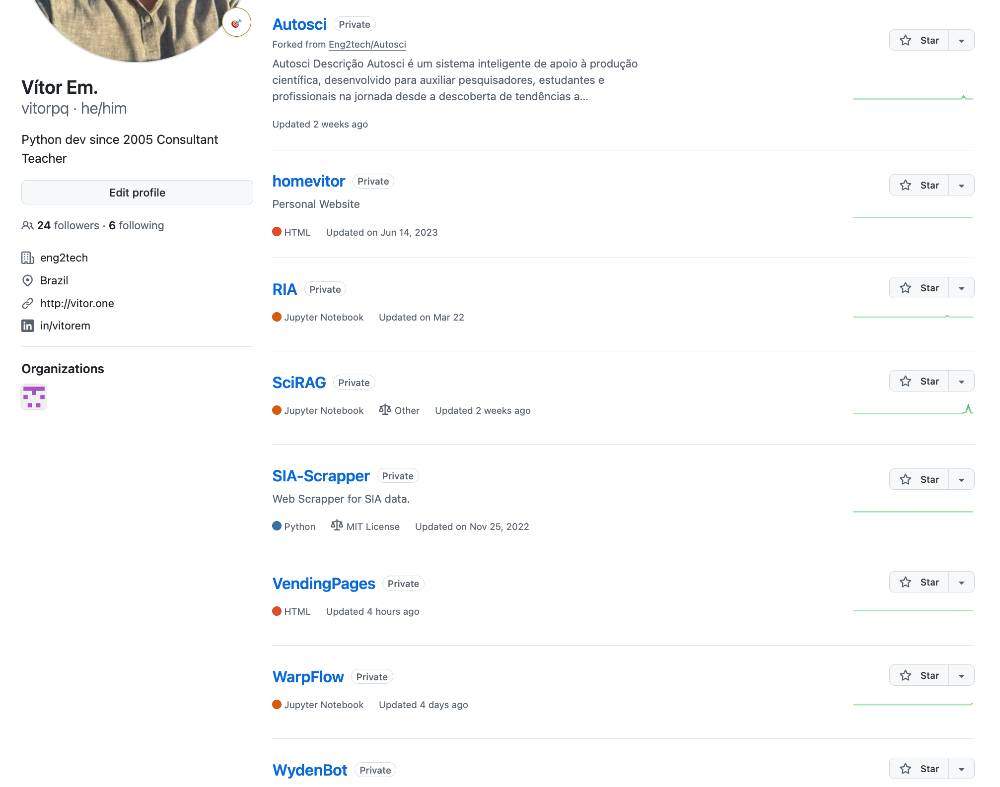

# 👋 Olá! Eu sou Vítor Emmanuel

Sou um desenvolvedor e consultor com uma jornada multidisciplinar, atuando nos cruzamentos entre **Inteligência Artificial, Análise de Dados, Automação de Processos e Mercado Financeiro**.

Meu objetivo é **resolver problemas reais com soluções práticas**, acessíveis e eficientes — usando tecnologia de ponta, sem complicação.

---

## 🚀 O que eu faço

### 👨‍💻 Desenvolvimento & Automação
- Criação de **agentes inteligentes e automações com Python**
- Desenvolvimento de **RAG systems** (Retrieval-Augmented Generation) para análise de documentos
- Integração de APIs e automações com **n8n**, **LangChain**, **Google Sheets/Docs**
- Processamento de dados e **ETL pipelines** com Python
- Automação de relatórios financeiros, planilhas e sistemas de gestão

### 🧠 Inteligência Artificial
- Processamento de linguagem natural (NLP) e geração de texto com **LLMs**
- Chatbots personalizados integrados ao **WhatsApp (WAHA API + LangChain)**
- Classificação, busca vetorial e análise de imagens com **YOLO, Re-ID e embeddings**

### 📈 Finanças & Dados
- Modelos preditivos para o **mercado de capitais**
- Criação de **estratégias de trading** com IA e price action
- Projetos em **quantitative finance** com backtesting de portfólios
- Consultoria em **gestão financeira para PMEs**
---

## 🧰 Tecnologias e Ferramentas
`Python` | `LangChain` | `Docker` | `n8n` | `Google Workspace APIs`  
`Turso` | `FAISS` | `Streamlit` | `Pandas` | `OpenAI / Gemini API`  
`Git & GitHub` | `Linux Server` | `PostgreSQL` | `MySQL` 

---

## 🛠 Projetos em Destaque

- 🔍 **SciRAG**: Sistema de leitura de artigos científicos com IA + busca vetorial.
- 🤖 **Assistente Financeiro Inteligente**: Automatiza leitura de DREs e análise financeira.
- 📊 **WarpFlow**: Sistemas de automação de cálculos trabalhistas.
- 🔌 **Integrações com WhatsApp e Google Sheets** para automação de orçamentos e relatórios.

> Veja todos os projetos nos repositórios deste perfil.

> Seguem alguns projetos que estão privados, pois são soluções para clientes.

---

## 💼 Sobre mim

Sou professor universitário, consultor financeiro e fundador da [Eng2Tech Tecnologia e Soluções](https://www.eng2tech.com).  
Atuo conectando tecnologia, negócios e educação de forma acessível para pequenas e médias empresas. Também sou entusiasta de **trading algorítmico** e **gestão de portfólios com IA**.

---

## 📬 Entre em Contato

Estou disponível para **projetos freelance**, **consultorias** e **colaborações**.  
Fale comigo:

- 📧 **vitor@eng2tech.com**  
- 💼 [LinkedIn](https://www.linkedin.com/in/vitorem)  
- 🌐 [www.eng2tech.com.br](https://www.eng2tech.com)

---

> ⭐ Sinta-se à vontade para explorar os repositórios, abrir issues, ou entrar em contato para criarmos algo incrível juntos!

<!---
vitorpq/vitorpq is a ✨ special ✨ repository because its `README.md` (this file) appears on your GitHub profile.
You can click the Preview link to take a look at your changes.
--->

---
*Este README foi atualizado automaticamente em 2026-06-23 09:23:59.*
